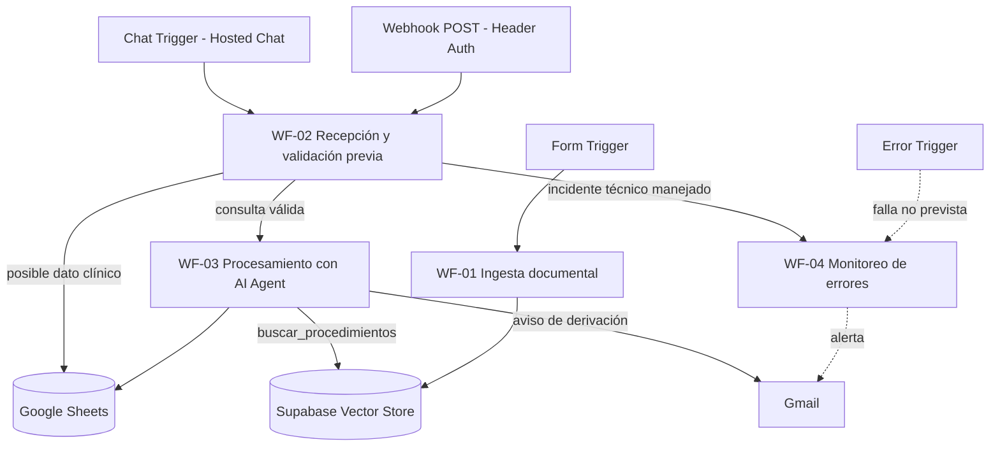

# Arquitectura del Proyecto Final

- **Documento:** ARQUITECTURA_PROYECTO_FINAL
- **Versión:** 2.0
- **Fecha:** 17/11/2026
- **Estado:** sistema implementado y probado en n8n Cloud. Paso 17 cerrado. Ningún workflow está publicado.
- **Sistema:** Asistente Inteligente de Procesos Internos con RAG
- **Empresa:** Cordal Tecnología S.A. (empresa ficticia, prototipo académico)
- **Versión anterior:** 1.0 del 15/11/2026, con la arquitectura aprobada antes de la construcción. Los cambios están en la sección 19.

Este documento describe la arquitectura tal como quedó implementada y probada. Para cada componente se distingue entre:

- **Implementado:** existe en n8n con esa configuración.
- **Probado:** verificado en una ejecución real. El detalle está en REGISTRO_PRUEBAS_PASO_17.
- **Limitación:** comportamiento conocido que no se corrige en el prototipo.
- **Pendiente de producción:** configuración que no se aplica en el prototipo académico.

Los valores económicos son estimaciones basadas en supuestos, no mediciones.

## 1. Estado de los componentes

| Componente | Implementado | Probado | Observaciones |
|---|---|---|---|
| WF-01 Ingesta documental RAG | Sí (14 nodos) | Sí (ejecuciones 91 a 93) | Rechaza procedimientos ya cargados; no actualiza versiones |
| WF-02 Recepción | Sí (15 nodos) | Sí (Prueba 14 y Prueba 15 bis) | Chat probado desde el editor; el Hosted Chat publicado no se probó |
| WF-03 Procesamiento con AI Agent y RAG | Sí (31 nodos) | Sí (Pruebas 5 a 14) | Envío de Gmail deshabilitado; un único envío real autorizado (Prueba 13) |
| WF-04 Monitoreo de errores | Sí (13 nodos) | Sí (Prueba 15: S1 a S3b, R1 y 15 bis) | Envío de Gmail deshabilitado; no vinculado como workflow de errores |
| Supabase Vector Store | Sí | Sí | 70 fragmentos de 5 procedimientos, vectores de 3072 dimensiones |
| Google Sheets (Empleados, Solicitudes, Consultas) | Sí | Sí | Consultas con 16 columnas (incluida `estado_aviso`) |
| Publicación (Hosted Chat y Production URL del webhook) | Configurado | No | Pendiente de producción |
| WF-04 como workflow de errores de WF-02 y WF-03 | No | No | Pendiente de producción (sección 17) |

## 2. Decisiones vigentes

| Tema | Decisión |
|---|---|
| Cantidad de workflows | Cuatro |
| Entradas de consultas | Chat Trigger (Hosted Chat, interfaz principal) y Webhook POST con autenticación por encabezado |
| Entrada de la ingesta | Form Trigger con carga de archivos Markdown |
| Fuentes de datos consultadas | Google Sheets (Empleados y Solicitudes) y Supabase (procedimientos vectorizados) |
| Valores de `origen` | CHAT o WEBHOOK, fijados por el workflow |
| Acceso al chat y al formulario | Autenticación n8n User Auth |
| Identificación del empleado | Simulada, mediante legajo `LEG-NNNN` al inicio del mensaje; no es autenticación |
| Memoria conversacional | Sin memoria |
| Modelo del agente | Google Gemini en la nube, `gemini-3.5-flash-lite` |
| Embeddings | Nodo nativo Embeddings Google Gemini, `gemini-embedding-001`, 3072 dimensiones |
| Vector Store | Supabase con pgvector, `vector(3072)`, similitud coseno, sin índice vectorial |
| Herramientas del agente | Solo lectura: `buscar_procedimientos` y `consultar_mis_solicitudes` |
| Escrituras | Solo nodos fijos del workflow (registro en Consultas, estado del aviso); nunca el modelo |
| Avisos y alertas por Gmail | Implementados, con lista de destinatarios autorizados y envío deshabilitado |
| Google Sheets y Gmail | Cuenta personal de pruebas |

## 3. Diagrama general

Las líneas punteadas indican rutas implementadas y probadas que dependen de configuración pendiente de producción:

- El Error Trigger solo se activa en workflows que tengan a WF-04 como workflow de errores.
- El envío de Gmail en WF-04 está deshabilitado.

## 4. Workflows

| Workflow | Función | Disparadores | Conservación de ejecuciones |
|---|---|---|---|
| WF-01 Ingesta | Carga procedimientos nuevos en el Vector Store | Form Trigger | Configuración por defecto de la instancia |
| WF-02 Recepción | Recibe la consulta, la valida antes del modelo, llama a WF-03, responde y reporta incidentes | Chat Trigger y Webhook | No guarda ejecuciones (producción, errores, manuales ni progreso) |
| WF-03 Procesamiento | Valida al empleado, ejecuta el agente, registra y prepara el aviso | Execute Workflow Trigger (llamado desde WF-02) | Configuración por defecto de la instancia, como evidencia de las pruebas |
| WF-04 Monitoreo | Clasifica fallas e incidentes y prepara la alerta | Error Trigger y Execute Workflow Trigger | No guarda ejecuciones |

### 4.1 WF-01 Ingesta documental RAG

1. **Formulario de carga** (Form Trigger, n8n User Auth): uno o más archivos `.md`.
2. **Leer archivos y metadatos** (Code):
   - Extrae identificador, versión y título del encabezado.
   - Rechaza archivos que no sean Markdown, que no tengan identificador o versión, o que repitan un procedimiento en la misma carga.
3. **Documento válido** (IF): los rechazados van a **Documento rechazado** (Edit Fields), sin escritura.
4. **Buscar procedimiento existente** (Supabase, lectura): busca por `metadata->>procedimiento`, con límite 1. Es el primer acceso a Supabase y ocurre antes de cualquier escritura.
5. **Clasificar por existencia** (Code) y **Procedimiento no cargado** (IF): solo pasan los procedimientos nuevos. Los existentes van a **Procedimiento ya cargado**, que devuelve RECHAZADO sin modificar la base.
6. **Dividir en secciones** (Code): un elemento por sección `## N.`, más el encabezado como sección 0.
7. **Supabase Vector Store** (Insert), tabla `documents`, función `match_documents`, con:
   - Embeddings Google Gemini (`gemini-embedding-001`).
   - Default Data Loader, con metadatos `tipo_documento`, `procedimiento`, `version`, `titulo`, `archivo_origen`, `seccion_numero` y `seccion_titulo`.
   - Recursive Character Text Splitter de 1600 caracteres, con 150 de solapamiento y modo Markdown.
8. **Resumen de la ingesta** (Code): documentos recibidos, válidos y fragmentos insertados por procedimiento.

Cambio respecto de v1.0: se eliminó el borrado previo de fragmentos (sección 19).

### 4.2 WF-02 Recepción

| Nodo | Función |
|---|---|
| Chat de empleados (Chat Trigger) | Hosted Chat con n8n User Auth; respuesta del último nodo. No carga sesiones anteriores ni acepta archivos, no guarda datos destacados y no incluye al usuario de n8n en la salida |
| Consulta por webhook (Webhook) | POST `/cordal-consultas`, Header Auth, respuesta mediante el nodo "Responder al webhook", "Ignore Bots" desactivado |
| Normalizar chat / Normalizar webhook (Code) | Toman solo el texto (y en el webhook, `legajo` opcional). Cualquier otro campo del cuerpo se ignora |
| Validación previa (Code) | Lógica fija, sin IA. Detalle a continuación |
| Ruta de la consulta (Switch) | Válida, Bloqueada por salud o Rechazada |
| Procesar en WF-03 (Execute Sub-workflow) | Llama a WF-03 con espera; ante un error continúa por la salida normal |
| Preparar registro de bloqueo + Registrar bloqueo (Code + Google Sheets) | Registra en Consultas el bloqueo por posible dato clínico, con resumen fijo |
| Respuesta final (Code) | Determina el canal por el disparador ejecutado. Chat: solo el texto. Webhook: JSON de 7 campos |
| Canal webhook (IF) → Responder al webhook / Respuesta del chat | Separa la respuesta de cada canal. El webhook devuelve `id_consulta`, `origen`, `respuesta`, `decision`, `estado_procesamiento`, `registro` y `aviso`, sin reenviar encabezados |
| Detectar incidente (Code) | Rama de monitoreo. Lee resultados ya calculados y emite un incidente solo ante un error técnico |
| Reportar incidente a WF-04 (Execute Sub-workflow) | Llama a WF-04 sin esperar, con 10 campos técnicos; ante un error continúa |

Reglas de "Validación previa":

- Genera `id_consulta` = `CON-<ID de ejecución de WF-02>` y `fecha_hora` (zona de Buenos Aires). El usuario no puede elegirlos.
- Rechaza un mensaje vacío o de más de 1000 caracteres.
- Rechaza si falta el legajo al inicio, si el formato es inválido o si el legajo del campo no coincide con el del mensaje.
- Si detecta posible información clínica por patrones, la consulta sigue la ruta "Bloqueada por salud": no llega a WF-03 ni al modelo.

Las consultas rechazadas no se registran. Los bloqueos por salud sí se registran, con texto fijo.

Orden de ejecución: "Detectar incidente" está ubicado por encima de "Canal webhook". Así la rama de monitoreo se ejecuta primero y la respuesta del chat sigue siendo la del último nodo.

### 4.3 WF-03 Procesamiento

Cuatro grupos de nodos.

**Validación del empleado y del acceso (sin IA):**

1. **Recibir consulta** (Execute Workflow Trigger): `id_consulta`, `origen`, `legajo`, `mensaje` y `fecha_hora`.
2. **Buscar empleado** (Google Sheets, lectura de Empleados, filtro por legajo, 2 intentos).
3. **Validar empleado** (Code):
   - Verifica el formato del legajo, que exista una sola fila, que la fila corresponda al legajo y que el empleado esté activo.
   - Solo deja pasar sede, fecha de ingreso y saldo de vacaciones.
   - Ante una falla de lectura: ERROR con `ERR_SHEETS`.
4. **Empleado habilitado** (IF).
5. **Leer solicitudes propias** (Google Sheets, lectura de Solicitudes, filtro fijo por el legajo validado, 2 intentos).
6. **Control de acceso a solicitudes** (Code):
   - Si el mensaje menciona un número de solicitud que no es propio, prepara una denegación fija (BLOQUEADO) sin revelar si existe.
   - Recorta cada solicitud a 6 campos.
7. **Solicitudes autorizadas** (IF).
8. **Respuesta sin agente** (Code): salida fija para legajo inexistente o inactivo, solicitud no propia o falla de lectura.

**AI Agent con RAG:**

9. **Agente de procesos internos** (AI Agent): detalle en la sección 5.
10. **Validar decisión** (Code): recibe la salida normal y la de error del agente (sección 5.3).

**Registro en Consultas:**

11. **Preparar registro** (Code): arma la fila de 16 columnas con datos controlados y un resumen sanitizado, nunca el mensaje original.
12. **Buscar consulta registrada** (lectura) → **Decidir inserción** → **Consulta nueva** (IF): evita duplicados por `id_consulta`.
13. **Registrar consulta** (Google Sheets, agregar fila, formato RAW, sin reintentos) → **Confirmar registro**.
14. **Resultado del registro** (Code): `registro` = REGISTRADA, YA_REGISTRADA o NO_REGISTRADA.

**Aviso de derivación:**

15. **Configuración del aviso** (Code): lista de destinatarios autorizados, destinatario y `AVISO_ENVIO_HABILITADO`. Envío deshabilitado.
16. **Preparar aviso** (Code): condiciones fijas y control de contenido (sección 9).
17. **Enviar aviso** (IF) → **Enviar correo de aviso** (Gmail, sin reintentos, continúa ante un error) → **Resultado del aviso** → **Registrar estado del aviso** (IF) → **Actualizar estado del aviso** (Google Sheets, actualización de `estado_aviso`) → **Confirmar estado del aviso**.
18. **Respuesta final** (Code): devuelve a WF-02 la respuesta, la clasificación, `registro` y el objeto `aviso`.

Configuración: política de llamadas por defecto (workflows del mismo propietario). Restringirla a WF-02 queda pendiente de producción.

### 4.4 WF-04 Monitoreo de errores

| Nodo | Función |
|---|---|
| Falla no prevista (Error Trigger) | Fallas automáticas de los workflows que lo tengan como workflow de errores |
| Incidente controlado (Execute Workflow Trigger) | Incidentes técnicos manejados por WF-02. Recibe 10 campos fijos |
| Normalizar falla no prevista (Code) | Toma solo workflow, ejecución, último nodo y modo. El texto del error se usa para detectar "pistas" de un vocabulario fijo y nunca se copia |
| Normalizar incidente controlado (Code) | Acepta solo valores de listas cerradas y vuelve a aplicar las reglas de detección |
| Clasificar y validar incidente (Code) | Circuito único para ambas entradas: código, categoría, severidad, validación de formato y clave del incidente |
| Es incidente (IF) | Los casos normales no generan alerta |
| Evitar duplicados (Code) + Incidente nuevo (IF) | Claves notificadas en datos estáticos del workflow (24 h, máximo 200) |
| Configuración de alerta (Code) | Lista autorizada vacía, destinatario vacío, envío deshabilitado |
| Preparar alerta (Code) | Asunto y cuerpo con campos fijos y control de contenido previo al envío |
| Enviar alerta (IF) → Enviar alerta por Gmail | Gmail sin reintentos; continúa ante un error |
| Resultado del monitoreo (Code) | NO_CORRESPONDE, DUPLICADA, NO_ENVIADA, ENVIADA, ERROR o VERIFICACION_MANUAL |

Códigos de incidente:

| Código | Categoría | Severidad |
|---|---|---|
| `FALLA_NO_PREVISTA` | Según la pista: PRUEBA_SINTETICA, CREDENCIAL_O_PERMISOS, CUOTA_O_LIMITE, TIEMPO_DE_ESPERA, CONEXION, SERVICIO_EXTERNO, ERROR_DE_CODIGO, RECURSO_NO_ENCONTRADO u OTRA | Alta |
| `INTEGRACION_WF03` | INTEGRACION | Alta |
| `ERR_SHEETS` | REGISTRO_SHEETS | Alta |
| `ERROR_PROCESAMIENTO` | PROCESAMIENTO | Alta |
| `REGISTRO_NO_CONFIRMADO` | REGISTRO_SHEETS | Alta |
| `AVISO_ERROR_ENVIO` | AVISO_GMAIL | Media |
| `AVISO_VERIFICACION_MANUAL` | AVISO_GMAIL | Media |

No generan alerta: bloqueos de privacidad, legajos inválidos, consultas rechazadas y avisos no enviados porque Gmail está deshabilitado.

Configuración:

- Solo WF-02 puede llamarlo como subworkflow.
- No guarda ejecuciones.
- Envío de Gmail deshabilitado.

## 5. AI Agent

### 5.1 Configuración

| Elemento | Valor |
|---|---|
| Nodo | AI Agent |
| Modelo | Google Gemini Chat Model, `gemini-3.5-flash-lite`, temperatura 0,2, máximo 2048 tokens de salida |
| Iteraciones | Máximo 6; devuelve los pasos intermedios para auditar el uso de herramientas |
| Reintentos | 2 intentos, 3 segundos de espera; salida de error conectada a "Validar decisión" |
| Entrada al modelo | Fecha y consulta delimitadas como datos; el legajo inicial se quita del texto |
| Datos del empleado enviados | Solo sede, fecha de ingreso y saldo de vacaciones |
| Memoria | Ninguna |
| Salida | Structured Output Parser con esquema JSON manual y listas cerradas |
| System prompt | SYSTEM_PROMPT_WF-03, versión 1.4 |

### 5.2 Herramientas (solo lectura)

| Herramienta | Nodo | Uso |
|---|---|---|
| `buscar_procedimientos` | Supabase Vector Store en modo herramienta, con Embeddings Google Gemini | Recupera 5 fragmentos por búsqueda, con metadatos de procedimiento y sección |
| `consultar_mis_solicitudes` | Code Tool sin parámetros | Entrega las solicitudes del empleado validado, ya leídas y recortadas por el workflow: `id_solicitud`, `procedimiento`, `estado`, `fecha_estado`, `fecha_inicio`, `fecha_fin` |

El modelo no aporta ningún parámetro a las lecturas de Google Sheets. El legajo lo fija el workflow.

### 5.3 Decisión estructurada y validación

El agente devuelve `decision` (RESPONDER, SOLICITAR_ACLARACION o DERIVAR), `procedimiento`, `categoria`, `area_destino`, `urgencia`, `respuesta`, `resumen`, `fuentes` e `id_solicitud`.

"Validar decisión" aplica reglas fijas:

- Valores permitidos y coherencia entre campos (por ejemplo, área solo con DERIVAR; incidente de seguridad con Seguridad Informática y urgencia Alta).
- Toma `id_consulta`, `origen`, `legajo` y `fecha_hora` del disparador, nunca del modelo.
- Cada fuente citada debe haber sido recuperada por `buscar_procedimientos` en la misma consulta. Completa la lista de fuentes con secciones citadas que fueron recuperadas.
- Rechaza solicitudes no autorizadas o campos fuera de los seis permitidos.
- Si `procedimiento` = SIN_CLASIFICAR, fuerza `categoria` = SIN_CLASIFICAR.
- Advertencias heurísticas: lenguaje de aprobación y afirmación de acciones no ejecutadas.
- Ante una falla, devuelve ERROR con `ERR_LLM_SALIDA_INVALIDA`, `ERR_VECTOR_STORE`, `ERR_LLM_TIMEOUT` o `ERR_LLM_NO_DISPONIBLE`, `decision` vacía y una respuesta fija.

La decisión es una clasificación y una recomendación de ruta de atención. No es una aprobación ni una decisión oficial de las áreas responsables.

### 5.4 Por qué un AI Agent y no un nodo de IA simple

En cada consulta el agente decide:

- Si necesita buscar en los procedimientos, consultar las solicitudes del empleado, hacer ambas cosas o ninguna.
- Si responde, pide aclaración o deriva, y en ese caso a qué área y con qué urgencia.

Un nodo de IA simple transforma texto, pero no elige herramientas ni rutas. Las pruebas muestran decisiones distintas según el caso: búsquedas en los procedimientos, uso de la herramienta de solicitudes sin búsqueda en consultas de estado, y una o dos búsquedas según la consulta.

### 5.5 Sin memoria conversacional

Cada mensaje se procesa de forma independiente:

- Debe incluir el legajo y la consulta completa.
- Tras un SOLICITAR_ACLARACION, el empleado debe reescribir la consulta.
- El chat muestra el historial aunque el asistente no lo recuerde; el mensaje inicial del chat lo aclara.

## 6. Modelo: Gemini en la nube frente a Ollama local

| Criterio | Gemini en la nube | Ollama local |
|---|---|---|
| Infraestructura | Funciona directo desde n8n Cloud | Exige exponer un servidor propio o dejar n8n Cloud |
| Costo al volumen previsto | Bajo, por uso | Sin costo por uso, con equipo y mantenimiento |
| Privacidad | El texto sale a un proveedor externo | Los datos no salen de la empresa |
| Uso de herramientas | Probado en la Preentrega 4 y en este proyecto | Requiere validación con un modelo chico |
| Independencia | Depende del proveedor | No depende de terceros |

Se elige Gemini por viabilidad en n8n Cloud, costo y plazo. La privacidad se cubre con:

- La validación previa al modelo.
- La minimización de datos enviados (sección 5.1).
- El uso exclusivo de datos ficticios.

En el nivel gratuito de la API de Gemini, el contenido puede ser usado por el proveedor para mejorar sus productos; en el nivel pago, no. Con datos reales corresponde el nivel pago o reevaluar un modelo local.

Dependencia observada: con diez consultas casi simultáneas se superó el límite de solicitudes de la credencial (Prueba 6). Cada consulta con agente genera al menos dos llamadas al modelo y una de embeddings.

## 7. RAG: embeddings y Vector Store

- **Fuente:** cinco procedimientos ficticios (PRO-RH-001, PRO-RH-002, PRO-AF-001, PRO-IT-001, PRO-LG-001), versión 1.0.
- **Embeddings:** `gemini-embedding-001` mediante el nodo nativo, 3072 dimensiones. El nodo no permite reducir la dimensión.
- **Almacenamiento:** tabla `documents` (`content`, `metadata`, `embedding vector(3072)`) y función `match_documents` con distancia coseno, en Supabase con pgvector.
  - RLS activado sin políticas.
  - Permisos solo para el rol de servicio.
  - Sin índice vectorial: el volumen es menor a 100 fragmentos.
- **Fragmentación:** por secciones Markdown; 1600 caracteres y 150 de solapamiento. Ninguna sección se parte.
- **Carga verificada:** 70 fragmentos (14 por procedimiento), sin vectores nulos ni secciones duplicadas, con contenido idéntico a los archivos aprobados.
- **Recuperación:** 5 fragmentos por búsqueda; el agente puede hacer hasta tres búsquedas.
- **Regla de consistencia:** la ingesta y la consulta usan el mismo modelo y la misma dimensión.

| Criterio | Supabase | Simple Vector Store |
|---|---|---|
| Persistencia | Permanente en una base externa | En memoria; se pierde al reiniciar n8n |
| Costo | Plan gratuito suficiente para el prototipo | Sin costo |
| Fiabilidad | Estable; el plan gratuito pausa proyectos con poca actividad | No apta fuera de una demostración |

### Por qué RAG y no una consulta estática

Los procedimientos suman más de 8.000 palabras, tienen versiones, plazos y excepciones, y el asistente debe citar la sección que usó. Incluir todo el texto en el prompt no escala ni permite actualizar un documento sin tocar el agente. Además, la validación de fuentes depende de saber qué secciones se recuperaron en cada consulta.

## 8. Datos en Google Sheets

Planilla de datos ficticios con tres pestañas. El detalle de columnas y valores permitidos está en DISENO_BASE_DATOS_PROYECTO_FINAL, versión 1.1.

| Pestaña | Uso | Acceso |
|---|---|---|
| Empleados | 20 legajos ficticios (uno inactivo) | Lectura por legajo |
| Solicitudes | 15 solicitudes ficticias de los cinco procedimientos | Lectura por legajo |
| Consultas | Una fila por consulta procesada; 16 columnas, incluida `estado_aviso` | Lectura por `id_consulta`, alta de filas y actualización de `estado_aviso` |

## 9. Avisos y alertas por Gmail

| Aspecto | Aviso de derivación (WF-03) | Alerta de monitoreo (WF-04) |
|---|---|---|
| Cuándo corresponde | DERIVAR, COMPLETADO, consulta registrada en esta ejecución, área permitida, fila Pendiente con `estado_aviso` = PENDIENTE | Incidente técnico nuevo (no duplicado) |
| Destinatario | Solo una casilla de la lista autorizada; nunca `@cordal.example` | Igual criterio |
| Contenido | Datos de la fila registrada con el resumen sanitizado; nunca el mensaje original | Campos técnicos fijos; nunca mensajes, legajos, encabezados ni errores técnicos |
| Control de contenido | Bloquea correos, términos sensibles, números largos e importes | Bloquea arrobas, legajos, números largos, tokens, encabezados y trazas |
| Reintentos | Ninguno | Ninguno |
| Estado actual | Deshabilitado | Deshabilitado, sin destinatario |
| Probado | Un envío real (Prueba 13) | Hasta la preparación de la alerta, sin envío |

Resultado incierto de Gmail (tiempo de espera, error 5xx o respuesta sin identificador): VERIFICACION_MANUAL. No se reintenta ni se marca como no enviado.

La recuperación manual de avisos está documentada en el registro de pruebas (Prueba 12).

## 10. Credenciales y servicios

| Servicio | Tipo de credencial en n8n |
|---|---|
| Google Gemini (chat y embeddings) | Clave de API |
| Google Sheets | OAuth2 de la cuenta personal de pruebas |
| Gmail | OAuth2 de la cuenta personal de pruebas |
| Supabase | URL del proyecto y clave de servicio |
| Webhook de WF-02 | Header Auth (encabezado `X-Cordal-Token`) |
| Hosted Chat y formulario de ingesta | n8n User Auth |

Ninguna clave, token ni contraseña se incluye en este documento. Los JSON de los workflows todavía no se exportaron: en la etapa C se exportarán, revisarán y sanearán para comprobar que no contengan secretos ni datos personales. Las referencias a las credenciales deberán volver a configurarse al importar.

## 11. Controles de privacidad y seguridad

1. **Validación antes del modelo:** la posible información clínica no llega a WF-03 ni a Gemini.
2. **Minimización:** al modelo solo llegan la consulta sin legajo, tres datos del empleado y seis campos por solicitud propia.
3. **Acceso a solicitudes:**
   - Filtro fijo por el legajo validado.
   - Denegación previa al agente de solicitudes no propias.
   - Segunda verificación en "Validar decisión".
4. **Registro sin contenido original:** Consultas guarda un resumen sanitizado o un texto fijo.
5. **Conservación de ejecuciones:**
   - WF-02 y WF-04 no guardan ejecuciones.
   - WF-03 conserva las suyas como evidencia; contienen datos ficticios.
6. **Webhook:**
   - Header Auth.
   - Respuesta construida campo por campo; nunca devuelve el ítem del disparador ni sus encabezados.
   - Campos internos enviados por el cliente ignorados.
7. **Acceso al chat y al formulario:** n8n User Auth.
8. **Identidad simulada:** el legajo no es autenticación. En producción hace falta autenticación real.

Incidente registrado y remediado: durante la Prueba 14 una respuesta de prueba del webhook expuso el valor del encabezado de autenticación. Se aplicaron estas medidas:

- Se rotó el token.
- Se eliminaron las ejecuciones afectadas.
- Se corrigió la respuesta del webhook.
- WF-02 dejó de guardar ejecuciones.

El detalle está en el registro de pruebas.

## 12. Manejo de errores

| Falla | Detección | Resultado | Estado |
|---|---|---|---|
| Gemini no disponible o límite de solicitudes | Reintentos y salida de error del agente | `ERR_LLM_NO_DISPONIBLE`, respuesta fija, fila ERROR; WF-02 reporta `ERROR_PROCESAMIENTO` a WF-04 | Probado (límite real, ejecuciones 118, 120 y 122) |
| Salida del agente inválida o incoherente | Parser y "Validar decisión" | `ERR_LLM_SALIDA_INVALIDA`, respuesta fija | Probado (ejecución 140) |
| Tiempo de espera del modelo | Salida de error del agente | `ERR_LLM_TIMEOUT` | Implementado; no provocado |
| Vector Store no disponible | Error de la herramienta | `ERR_VECTOR_STORE` | Implementado; no provocado |
| Falla de lectura de Empleados o Solicitudes | Error por la salida normal del nodo | ERROR con `ERR_SHEETS`, sin agente | Probado (Prueba 9) |
| Falla de búsqueda o escritura en Consultas | "Decidir inserción" y "Confirmar registro" | ERROR con `ERR_SHEETS`, `registro` = NO_REGISTRADA, sin duplicar | Probado (Prueba 10) |
| WF-03 no responde o no existe | Salida normal del Execute Sub-workflow | Respuesta fija; WF-02 reporta `INTEGRACION_WF03` a WF-04 | Probado (Prueba 14 F y Prueba 15 bis) |
| Error de Gmail en un aviso | "Resultado del aviso" | ERROR_ENVIO o VERIFICACION_MANUAL, sin reintentos; WF-02 reporta `AVISO_ERROR_ENVIO` o `AVISO_VERIFICACION_MANUAL` a WF-04 | Ruta exitosa probada con un envío real (Prueba 13). Clasificación de fallas de Gmail probada solo con pruebas unitarias (Pruebas 12 y 13). Una falla real de Gmail y su reporte a WF-04 no se probaron de punta a punta |
| Falla no prevista en un workflow | Error Trigger de WF-04 | Alerta sanitizada `FALLA_NO_PREVISTA` | Probado con un workflow temporal (R1) |
| Datos de entrada inválidos | "Validación previa" de WF-02 | Respuesta fija, sin modelo ni registro | Probado (Prueba 14 D bis) |
| Manipulación del agente | System prompt, listas cerradas y validación | Mantiene el rol, no aprueba ni inventa datos | Probado (Prueba 6, S1 a S5) |

Registro de los errores en Consultas:

- Cuando la consulta llega a WF-03 y la escritura en Consultas funciona, el error queda registrado con su código, sin área de destino inventada, según el documento de diseño de la base de datos.
- Cuando falla la escritura en Consultas o la integración WF-02 → WF-03, puede no existir ninguna fila. En esos casos:
  - WF-03 informa `registro` = NO_REGISTRADA, o WF-02 informa `registro` = DESCONOCIDO.
  - La rama de monitoreo de WF-02 reporta el incidente a WF-04 (`ERR_SHEETS`, `REGISTRO_NO_CONFIRMADO` o `INTEGRACION_WF03`), cuando corresponde.
- Las consultas rechazadas en la validación previa no se registran, por diseño.

## 13. Salidas verificables

- Respuesta al empleado en el chat o, por el webhook, un JSON de 7 campos.
- Una fila en Consultas por cada consulta procesada, siempre que la escritura sea exitosa y confirmada. No todas las consultas generan una fila:
  - Las rechazadas en la validación previa no se registran.
  - Si la escritura falla o su resultado es incierto, el resultado es `registro` = NO_REGISTRADA.
  - Si falla la llamada a WF-03, el resultado es `registro` = DESCONOCIDO.
- Correo de aviso por cada derivación, cuando el envío está habilitado.
- Alerta de monitoreo por cada incidente técnico nuevo, cuando el envío está habilitado.

## 14. Casos de prueba de la versión 1.0 y resultado

| # | Caso | Resultado | Referencia |
|---|---|---|---|
| 1 | Respuesta informativa con RAG | Aprobado | Pruebas 5, 7 y 14 (A) |
| 2 | Consulta de estado de una solicitud | Aprobado | Pruebas 8, 9 y 14 (B) |
| 3 | Pedido de aclaración | Aprobado | Pruebas 5, 7 y 10 (D) |
| 4 | Derivación por decisión humana | Aprobado | Pruebas 5, 7 y 10 (B) |
| 5 | Incidente de seguridad informática | Aprobado, con aviso real por Gmail | Pruebas 5 y 13 |
| 6 | Tema fuera de alcance | Aprobado | Pruebas 5 y 6 |
| 7 | Bloqueo por dato sensible | Aprobado | Prueba 14 (G) |
| 8 | Mensaje sin legajo | Aprobado | Prueba 14 (D bis) |
| 9 | Legajo inexistente | Aprobado | Pruebas 8 y 10 |
| 10 | Legajo inactivo | Aprobado | Pruebas 8 y 14 (D) |
| 11 | Intento de manipulación del agente | Aprobado | Prueba 6 |
| 12 | Error de Gemini | Observado en condiciones reales (límite de solicitudes), no provocado deliberadamente | Prueba 6 |
| 13 | Error de Google Sheets | Aprobado (provocado) | Pruebas 9 y 10 |

Pruebas adicionales aprobadas:

- Solicitud ajena (Pruebas 8, 9 y 14 C).
- Prevención de duplicados (Prueba 10 E).
- Autenticación del webhook (Prueba 14 E).
- Monitoreo con WF-04 (Prueba 15: S1 a S3b, R1 y 15 bis).

## 15. ROI estimado

Todos los valores son supuestos. No son mediciones.

| Concepto | Supuesto | Resultado |
|---|---|---|
| Consultas mensuales | 400 empleados × 0,6 consultas | 240 |
| Tiempo humano por consulta | 8 minutos | 32 h al mes |
| Consultas resueltas sin intervención | 60 %, supuesto no medido | 19,2 h al mes |
| Valor del tiempo | USD 10 por hora | USD 192 al mes |
| Costo mensual del sistema | Sección 16 | USD 51 |
| Ahorro neto | | USD 141 al mes |
| Implementación | 40 h × USD 10 | USD 400; recupero en unos 3 meses |
| Umbral de conveniencia | USD 0,80 de ahorro por consulta recibida | Unas 64 consultas al mes |

Las pruebas usaron casos elegidos para cubrir escenarios, no una muestra representativa, así que no sirven para medir el porcentaje de resolución.

Dato medido en las pruebas, como referencia de desempeño y no de ROI: las consultas con agente y registro tardaron aproximadamente entre 10 y 17 segundos.

## 16. Costo operativo estimado

| Componente | Estimación mensual |
|---|---|
| n8n Cloud, plan inicial | USD 26 |
| Gemini (chat y embeddings) | Menos de USD 5 |
| Supabase, plan gratuito | USD 0 |
| Mantenimiento, 2 horas | USD 20 |
| **Total** | **USD 51** |

En producción convendría el plan pago de Supabase (unos USD 25 mensuales) para evitar la pausa por inactividad; el total pasaría a unos USD 76 y el recupero a unos 3,5 meses.

## 17. Configuración pendiente de producción

No se aplica en el prototipo académico.

1. Publicar WF-02 (Hosted Chat y Production URL del webhook) y WF-04.
2. Configurar WF-04 como workflow de errores de WF-02 y WF-03, y agregar WF-03 a los workflows autorizados para llamar a WF-04.
3. Restringir las llamadas a WF-03 solo a WF-02.
4. Definir las casillas reales de avisos y alertas, y habilitar los envíos.
5. Reemplazar el legajo simulado por autenticación real.
6. Nivel pago de Gemini (o modelo local) y plan pago de Supabase, si se usan datos reales.
7. Revisar la conservación de ejecuciones de WF-01 y WF-03 según la política de datos de la empresa.
8. Procedimiento de migración de versiones de documentos en el Vector Store.

## 18. Limitaciones conocidas

- **Sin actualización de versiones:** WF-01 solo carga procedimientos nuevos.
- **Filtro de salud por patrones:**
  - Puede tener falsos positivos y negativos.
  - El sanitizador de resúmenes reemplazó un resumen legítimo que contenía "certificado" (CON-216).
- **Hosted Chat:** probado solo desde el editor, sin publicar.
- **Deduplicación de WF-04:** usa datos estáticos, que n8n solo conserva en producción. No se probó la supresión de un segundo incidente igual.
- **Fallas no provocadas:** `ERR_VECTOR_STORE` y `ERR_LLM_TIMEOUT` no se provocaron en ejecuciones reales.
- **Concurrencia:** Google Sheets no garantiza unicidad ante consultas simultáneas con el mismo `id_consulta`, caso que no ocurre en el uso normal.
- **Límite de solicitudes de Gemini:** varias consultas simultáneas pueden superarlo.
- **Respuestas del agente:**
  - No informa importes ni el detalle de las solicitudes.
  - Las citas de fuentes pueden variar entre ejecuciones con el mismo mensaje.
- **Supabase:** el plan gratuito pausa el proyecto con poca actividad.

## 19. Historial de decisiones y cambios respecto de la versión 1.0

| Tema | Versión 1.0 (15/11/2026) | Versión 2.0 (implementado) | Motivo |
|---|---|---|---|
| WF-01, reingesta | Borrar los fragmentos anteriores antes de insertar | Rechazar procedimientos ya cargados, sin borrar | Un fallo después del borrado dejaría el procedimiento sin fragmentos (Prueba 4) |
| WF-01, fragmentación | Unos 1.500 caracteres | 1.600 caracteres | Dos secciones superan los 1.500 |
| WF-02, normalización | Edit Fields | Code nodes que ignoran campos no permitidos | El usuario no debe poder fijar campos internos |
| WF-02, respuesta del webhook | Último nodo | Nodo "Responder al webhook" con 7 campos explícitos | Incidente de exposición de encabezados (Prueba 14) |
| WF-02, Ignore Bots | Activado | Desactivado | Rechazaba con 403 a clientes automatizados válidos |
| WF-02, monitoreo | No previsto | Rama "Detectar incidente" hacia WF-04 | Los errores manejados no disparan el Error Trigger |
| WF-02, conservación | No guarda ejecuciones | No guarda ninguna, tampoco manuales | Riesgo de retener encabezados de autenticación |
| WF-03, solicitudes | Google Sheets Tool | Lectura fija + control de acceso + Code Tool con 6 campos | Minimización de datos y acceso restringido por regla fija (Pruebas 8 y 9) |
| WF-03, registro | Agregar fila | Búsqueda previa, inserción sin reintentos y confirmación | Evitar duplicados y no informar registros inciertos (Prueba 10) |
| WF-03, aviso | Switch → Gmail | Condiciones fijas, lista autorizada, control de contenido, `estado_aviso` y confirmación | Trazabilidad del aviso y prevención de envíos indebidos (Pruebas 11 a 13) |
| Consultas | 15 columnas | 16 columnas, con `estado_aviso` | Distinguir aviso enviado, pendiente o fallido (Prueba 12) |
| WF-04 | Error Trigger → Gmail; guarda ejecuciones | Dos entradas, normalización, clasificación, deduplicación y alerta sanitizada; no guarda ejecuciones | Cubrir los errores manejados por WF-02 y no conservar datos sensibles (Prueba 15) |
| Modelo | Gemini en la nube | `gemini-3.5-flash-lite` | Confirmado en la construcción |
| Ejecuciones simultáneas | Sin definir | Pruebas de a una | Límite de solicitudes de Gemini (Prueba 6) |

Decisiones de la versión 1.0 que se mantienen: cuatro workflows, Chat Trigger y Webhook como entradas, legajo simulado, sin memoria, Gemini en la nube, Supabase con `vector(3072)` y sin índice, nodo nativo de embeddings, y escrituras solo por nodos fijos.

## 20. Otros riesgos

| Riesgo | Mitigación |
|---|---|
| Errores 503 o demoras de Gemini | Reintentos, respuesta fija y registro con código de error |
| Pausa del proyecto Supabase por inactividad | Restaurar el proyecto antes de usarlo; plan pago en producción |
| Falsos positivos o negativos del filtro de privacidad | Documentado como limitación; ajustar términos con casos reales |
| Envío de correos a destinatarios no autorizados | Lista autorizada, envío deshabilitado y control de contenido |
| Exposición de secretos en exportaciones o capturas | Saneamiento y auditoría previos a la entrega |
